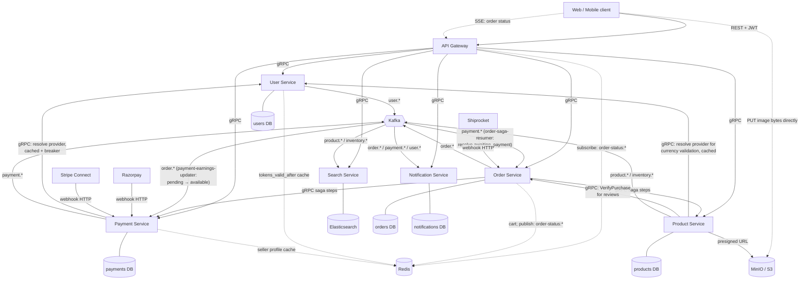
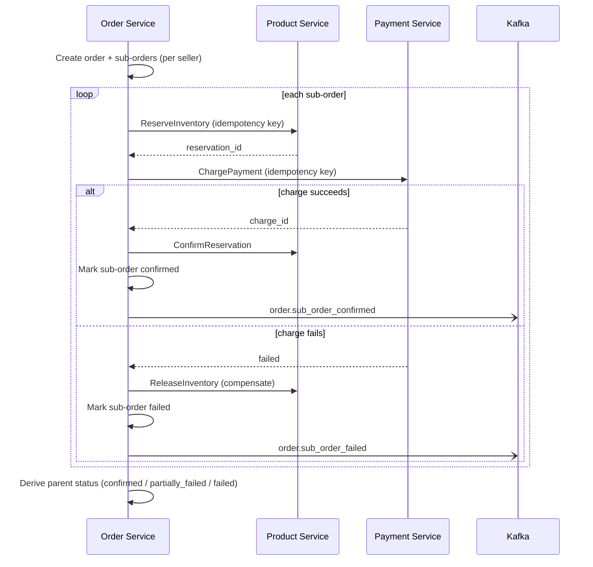

# Roast Co. Marketplace: E-Commerce Microservices Platform

A multi-vendor specialty coffee marketplace built as a Go microservices system with a React frontend. The product domain is deliberately simple so the engineering effort goes into distributed-systems concerns: sagas, idempotency, event-driven read models, and failure handling.

> This README is a living document. Sections marked **(planned)** describe intended design that is not implemented yet. See [Status](#12-status--roadmap).

---

## 1. Domain & Scope

A **multi-vendor marketplace** for specialty coffee. Independent roasters (sellers) list limited-batch coffees; buyers browse, search, and check out.

Why coffee: batches are limited, so inventory reservation is a real problem rather than a contrived one. The catalog stays flat (no size/color variant matrix), so the catalog service stays simple.

**Roles:** buyer, seller, admin (one `users` table, additive roles).

**Key behaviors**

- A buyer's cart can contain items from multiple sellers.
- Checkout looks like **one order** to the buyer. Behind the scenes it is split into **one sub-order per seller**, and each sub-order runs its own saga.
- The platform takes a commission (default 10%) on each sale. Sellers see their share and receive periodic payouts.

**Out of scope for now:** product variants, recommendations, coupons, multi-currency conversion, returns workflow beyond automatic refund on saga failure.

---

## 2. Architecture



**Reading the diagram:** solid arrows are synchronous gRPC/REST/webhook calls; dashed arrows are Redis (cache reads, pub/sub) or the direct-to-object-storage upload that bypasses every service. The two Kafka edges into Order and Payment are what make the checkout saga and the seller earnings ledger asynchronous and decoupled from each other, rather than Order and Payment calling one another more than the minimum the saga itself requires.

### Communication styles

| Style | Used for |
|---|---|
| REST (public) | Client to API Gateway only |
| gRPC (internal) | Gateway to services, and Order to Product/Payment during the saga |
| Kafka events | Side effects and read models: search indexing, notifications |
| Webhooks (HTTP) | Razorpay and Stripe (two separate listeners) to Payment Service; a generic shipping-carrier listener to Order Service (carrier TBD — see LLD.md §9) |

**Rule of thumb:** synchronous gRPC when the caller needs the result to continue (saga steps). Kafka when the consumer reacts independently (indexing, emailing).

---

## 3. Services

| # | Service | Protocol | Port | Owns | Storage |
|---|---|---|---|---|---|
| 1 | API Gateway | REST | 8080 | Routing, JWT validation, CORS, circuit breakers | none (Redis for sessions) |
| 2 | User | gRPC | 9001 | Identity for buyers/sellers/admins, seller profiles, tokens | Postgres `user_db` |
| 3 | Product | gRPC | 9002 | Catalog, listings, inventory + reservations (source of truth), reviews, image upload URLs | Postgres `product_db` + MinIO/S3 (images) |
| 4 | Search | gRPC | 9003 | Read-optimized catalog search, facets | Elasticsearch |
| 5 | Order | gRPC + HTTP webhook | 9004 / 9104 | Cart, checkout, saga orchestration, sub-orders, delivery confirmation | Postgres `order_db` + Redis (cart) |
| 6 | Payment | gRPC + HTTP webhooks | 9005 / 9105 | Charges, refunds, platform-fee split, seller ledger, payouts. Routes each charge to Razorpay (INR/UPI/cards/net banking) or Stripe Connect (USD/GBP/JPY cards) based on the seller's onboarded provider | Postgres `payment_db` |
| 7 | Notification | gRPC | 9006 | Emails and alerts to buyers and sellers | Postgres `notification_db` |

### Design decisions behind the split

- **No separate Seller or Payout service.** A seller profile extends a user record (User). Payouts live next to charges (Payment). Splitting them would add network hops and consistency edges without teaching a new pattern.
- **Search is its own service** and is a pure read model. It never writes back to Product. It builds its index only by consuming Kafka events, which keeps search load off Product's transactional database.
- **The cart lives in Order Service (Redis-backed)**, not in the gateway and not in its own service. It is pre-order state, and Order is the service that consumes it at checkout.
- **Each service owns its data.** No cross-service DB access or joins. Cross-service references are plain IDs (for example `seller_id` on a product).

---

## 4. Checkout Saga (orchestrated)

Order Service is the orchestrator. On `Checkout`, it splits the cart by seller and runs one saga per sub-order.



### Steps and compensations

| Step | Service | Action | Compensation if a later step fails |
|---|---|---|---|
| 1 | Product | `ReserveInventory` | `ReleaseInventory` |
| 2 | Payment | `ChargePayment` (computes fee split) | `RefundPayment` |
| 3 | Order | Confirm sub-order (+ `ConfirmReservation` on Product) | none (this is the commit point) |
| 4 | Notification | Send confirmations (via Kafka) | none, retry with backoff |

**Compensations run in reverse order.** Notification failures are retried, not rolled back, since an email is not something you undo.

**Parent order status** is derived from its sub-orders: all confirmed = `confirmed`, mixed = `partially_failed`, none = `failed`.

**Simplification above:** the diagram shows charge succeeding or failing immediately. UPI charges are asynchronous (the buyer approves in their UPI app, which can take minutes), so a sub-order can also land in `awaiting_payment` and get resolved later by a webhook or a timeout — see LLD.md §2.4/§3.4 for the full flow.

### Idempotency

Every state-changing saga RPC carries an idempotency key (`{sub_order_id}:{step}`) in `RequestMetadata`.

- For money and stock, the key is stored **in Postgres, in the same transaction** as the change it guards (`pkg/idempotency.Run`). Redis is not used for this: a lost key could cause a double charge.
- The stored response payload is returned verbatim on retry.
- Redis `SETNX` is acceptable only for low-stakes dedupe (for example not emailing twice).

### Event sourcing basics

- `order_db.saga_events`: append-only log of every saga step transition. `sub_orders.status` is a projection of it.
- `payment_db.ledger_entries`: append-only signed ledger. `seller_balances` is a cache rebuilt from it.

---

## 5. Data Design

Full DDL lives in each service's `migrations/001_init.sql`. Summary:

| Service | Key tables |
|---|---|
| User | `users`, `user_roles`, `seller_profiles`, `refresh_tokens` |
| Product | `products`, `inventory_reservations`, `reservation_lines`, `idempotency_keys` |
| Order | `orders`, `sub_orders`, `sub_order_items`, `saga_events`, `idempotency_keys` |
| Payment | `charges`, `refunds`, `ledger_entries`, `seller_balances`, `payouts`, `webhook_events`, `idempotency_keys` |
| Notification | `notifications` (doubles as dedupe + audit log) |
| Search | Elasticsearch `products` index (`services/search/migrations/001_index_mapping.jsonc`) |
| Redis | `cart:{buyer_id}` (JSON, TTL = reservation hold), sessions, `dedupe:*` keys |

**Conventions**

- Money is `BIGINT` minor units plus a currency code, restricted to 4 supported currencies: USD, INR, GBP, JPY (see LLD §1 for the JPY zero-decimal exception). Never floats.
- `stock_available = stock_total - stock_reserved` is derived, never stored. A `CHECK` prevents overselling.
- Reservation writes lock product rows (`SELECT ... FOR UPDATE`, ordered by `product_id`) to avoid races and deadlocks.
- Expired reservations are released by a background sweeper (planned).

---

## 6. Events (Kafka)

Envelope (`pkg/kafkaclient.Event`): `type`, `correlation_id`, `occurred_at`, `payload`. Messages are keyed by aggregate ID so events for one aggregate stay ordered on one partition.

| Topic | Event types | Producer | Consumers |
|---|---|---|---|
| `product.events` | `product.created`, `product.updated`, `product.deleted` | Product | Search |
| `inventory.events` | `inventory.changed` | Product | Search, Notification (low stock) |
| `order.events` | `order.sub_order_confirmed`, `order.sub_order_failed`, `order.shipped` | Order | Notification |
| `payment.events` | `payment.charge_succeeded`, `payment.refunded`, `payment.payout_paid` | Payment | Notification |

Consumers must be idempotent (at-least-once delivery). Offsets are committed only after the handler succeeds.

---

## 7. API Design (public REST via Gateway)

- **Versioned:** all routes under `/v1`.
- **Auth:** `Authorization: Bearer <JWT>` (access token from `POST /v1/auth/login`). Gateway validates; internal gRPC calls forward the token and services enforce roles.
- **Pagination:** cursor-based (`?page_size=20&page_token=...`), responses include `next_page_token`.
- **HATEOAS:** resources include `_links` so clients follow links instead of hard-coding URLs. Example:

```json
{
  "id": "a1092",
  "status": "processing",
  "total": { "currency_code": "USD", "amount_minor": 5900 },
  "_links": {
    "self":   { "href": "/v1/orders/a1092" },
    "cancel": { "href": "/v1/orders/a1092/cancel", "method": "POST" }
  }
}
```

- **Errors:** consistent JSON shape `{ "error": { "code": "...", "message": "...", "correlation_id": "..." } }`, mapped from gRPC status codes.
- **Idempotent writes:** `POST /v1/checkout` accepts an `Idempotency-Key` header.

### Route map

| Area | Routes |
|---|---|
| Auth | `POST /v1/auth/register`, `POST /v1/auth/login`, `POST /v1/auth/logout` |
| Catalog | `GET /v1/products`, `GET /v1/products/{id}`, `GET /v1/search` |
| Cart | `GET /v1/cart`, `POST /v1/cart/items`, `PUT /v1/cart/items/{productID}` |
| Checkout / orders | `POST /v1/checkout`, `GET /v1/orders`, `GET /v1/orders/{id}`, `GET /v1/orders/{id}/events` (SSE, LLD.md §2.4/§3.11), `POST /v1/orders/{orderID}/sub-orders/{subOrderID}/confirm-delivery` |
| Reviews | `GET /v1/products/{id}/reviews` (public), `POST /v1/reviews` (cross-checks purchase via Order Service — LLD.md §2.3/§3.8), `PUT /v1/reviews/{id}`, `DELETE /v1/reviews/{id}` |
| Seller | `POST /v1/seller/onboarding`, `GET /v1/seller/dashboard`, `GET/POST /v1/seller/listings`, `POST /v1/seller/listings/images/upload-url`, `GET /v1/seller/orders`, `POST /v1/seller/orders/{subOrderID}/ship`, `GET /v1/seller/payouts` |
| Admin | `GET /v1/admin/inventory`, `GET /v1/admin/orders`, `GET /v1/admin/sellers`, `POST /v1/admin/sellers/{id}/review` |
| Webhooks | `POST /webhooks/razorpay`, `POST /webhooks/stripe` on Payment Service; `POST /webhooks/shipping` on Order Service — none routed through the gateway |

---

## 8. Resilience & Observability

| Concern | Approach |
|---|---|
| Downstream failures | Circuit breaker per downstream (`pkg/middleware.Breaker`, sony/gobreaker) — one per service in the gateway, plus Payment Service's own breaker around its call to User Service (LLD.md §2.5 item 10) |
| Partial failure across services | Saga with compensating transactions |
| Duplicate/retried calls | DB-backed idempotency keys, webhook event dedupe table |
| Retries | Exponential backoff for notifications and Kafka handlers (planned) |
| Tracing | OpenTelemetry (`pkg/tracing`) exporting OTLP to Jaeger; trace context propagated over gRPC metadata |
| Logging | Structured JSON via `log/slog` (`pkg/logging`), tagged with `service` and `correlation_id` |
| Metrics | Prometheus + Grafana (**planned**) |
| Health | `/healthz` on the gateway; gRPC health service on internal services (planned) |

---

## 9. Tech Stack

- **Backend:** Go 1.22, gRPC + Protocol Buffers (buf for codegen), chi (gateway router)
- **Data:** PostgreSQL (pgx), Redis (go-redis), Elasticsearch/OpenSearch, MinIO/S3 (product images)
- **Messaging:** Kafka (segmentio/kafka-go)
- **Auth:** JWT (golang-jwt)
- **Payments:** Razorpay (INR/UPI/cards/net banking), Stripe Connect (USD/GBP/JPY cards) — routed per seller, see LLD.md §4.6
- **Observability:** OpenTelemetry, Jaeger
- **Frontend:** React + TypeScript + Vite
- **Infra:** Docker Compose

---

## 10. Project Structure

Go multi-module monorepo tied together with `go.work`.

```
ecommerce-platform/
├── README.md
├── go.work                     # workspace: pkg, gen/go, and every service
├── buf.yaml / buf.gen.yaml     # proto lint + codegen config
├── Makefile                    # (planned) proto, build, up, down, test
├── docker-compose.yml          # (planned) infra + all services + web
├── .env.example                # (planned)
│
├── proto/                      # source of truth for service contracts
│   ├── common/v1/common.proto      # Money, Address, PageRequest, RequestMetadata, SagaStepStatus
│   ├── user/v1/user.proto
│   ├── product/v1/product.proto
│   ├── search/v1/search.proto
│   ├── order/v1/order.proto
│   ├── payment/v1/payment.proto
│   └── notification/v1/notification.proto
│
├── gen/go/                     # GENERATED by `make proto` (do not hand-edit)
│
├── pkg/                        # shared libraries (own Go module)
│   ├── config/                 # typed env var helpers
│   ├── logging/                # slog JSON logger, correlation ID helpers
│   ├── tracing/                # OpenTelemetry init
│   ├── middleware/             # circuit breaker, gRPC JWT interceptor, role checks
│   ├── postgres/               # pgx pool wrapper
│   ├── idempotency/            # transactional idempotency helper
│   ├── redisclient/            # cart, sessions, SETNX dedupe
│   └── kafkaclient/            # producer/consumer + event envelope
│
├── services/                   # each is its own Go module + Dockerfile
│   ├── gateway/
│   │   ├── cmd/server/main.go
│   │   └── internal/{router,handlers,middleware}/
│   ├── user/
│   ├── product/
│   ├── search/                 # + internal/indexer (Kafka consumer -> Elasticsearch)
│   ├── order/                  # + internal/saga (orchestrator)
│   ├── payment/                # + internal/webhook (provider callbacks)
│   └── notification/
│       (each internal service:)
│       ├── cmd/server/main.go
│       ├── internal/{grpc,service,repository}/
│       └── migrations/001_init.sql
│
├── web/                        # React + Vite + TS frontend
│   └── src/
│       ├── pages/{auth,catalog,product,cart,checkout,orders,seller,admin}/
│       ├── components/  api/  hooks/  types/
│
└── deployments/                # (planned) compose overrides, k8s manifests later
```

**Layering inside each service:** `grpc` (transport, thin) calls `service` (business logic) calls `repository` (SQL). Only `repository` touches the database.

**Module paths** use the placeholder `github.com/roastco/ecommerce/...`. Replace with your real repo path before publishing.

---

## 11. Local Development (planned)

Once the scaffold is complete the intended flow is:

```bash
cp .env.example .env
make proto       # buf generate -> gen/go
make up          # docker compose up: postgres, redis, kafka, elasticsearch, jaeger, all services, web
make migrate     # apply each service's migrations
make test
```

Planned infra containers: Postgres (one server, one database per service for local dev; separate instances in production), Redis, Kafka (KRaft), Elasticsearch, Jaeger.

---

## 12. Status & Roadmap

**Done**

- [x] Domain, architecture, and service split decided
- [x] Proto contracts for all 7 services (`proto/`), generated with `make proto`
- [x] DB schemas per service (`services/*/migrations`)
- [x] Shared `pkg/` libraries: config, logging, tracing, middleware (circuit breaker, JWT interceptor), postgres, idempotency, redisclient, kafkaclient
- [x] API Gateway: all routes, auth/logging middleware, SSE order-status relay (compiles)
- [x] Local infrastructure: `docker-compose.yml` (Postgres, Redis, Kafka, Jaeger), `Makefile`, `.env.example`, shared Dockerfile
- [x] User Service: register/login/logout, JWT issuing, seller onboarding and admin approval, audit trail
- [x] Product, Order, Payment, Search, Notification services (gRPC services, repositories, and domain logic)
- [x] Order saga orchestrator (checkout fan-out, reserve -> charge -> confirm, compensations, Redis Pub/Sub status push)
- [x] Product reservation logic with deterministic row locking, releases, and reviews
- [x] Payment charge, platform-fee split, append-only ledger, seller balances, payouts, and webhooks (Razorpay and Stripe)
- [x] Search indexer (Kafka to Elasticsearch) and SearchService querying/facets
- [x] Notification Service dispatcher (Kafka consumers and dispatch worker)
- [x] Sweepers (reservation expiry, awaiting-payment timeout, auto-delivered)
- [x] `pkg/money` minor unit scales, fee calculation, and provider routing checks
- [x] Full `docker-compose.yml`, `Makefile`, and `go.work` covering all 7 microservices

**Not yet done**

- [ ] `Refresh` RPC (refresh tokens are issued and stored, but nothing can redeem them yet)
- [ ] Revocation enforced in the gRPC interceptor (today only `ValidateToken` checks `tokens_valid_after`)
- [ ] Gateway input validation; OpenTelemetry spans (tracing is initialised, nothing creates spans)
- [ ] React app (`web/`), Prometheus/Grafana

**Caveats**

- Nothing has been exercised end to end yet. Expect small fixes on first run.
- `pkg/postgres`, `pkg/idempotency` and `pkg/kafkaclient` were first compiled when the User Service started using them.

---

## 13. Open Decisions

- ~~Where reviews live~~ — **decided:** Product Service, verified against purchase history via a call to `OrderService.VerifyPurchase`. See LLD.md §2.3/§3.8.
- ~~Payment provider~~ — **decided:** Razorpay for INR/UPI/cards/net banking, Stripe Connect for USD/GBP/JPY cards, routed per seller. See LLD.md §4.6.
- ~~Saga sub-orders parallel vs. sequential~~ — **decided:** parallel, one goroutine per sub-order (LLD.md §2.4) — bounds `Checkout`'s latency to the slowest single sub-order, at the cost of needing per-sub-order `correlation_id`s to keep interleaved logs readable.
- ~~Seller payout schedule~~ — **decided:** weekly batch, every Monday, for `available` balances only (never `pending` — see LLD.md §2.5 for the pending/available distinction). On-demand payouts could be added later as a seller-initiated option without changing the underlying `RequestPayout` RPC.
- ~~Which shipping carrier to integrate~~ — **decided:** Shiprocket. See LLD.md §2.4, item 16.
